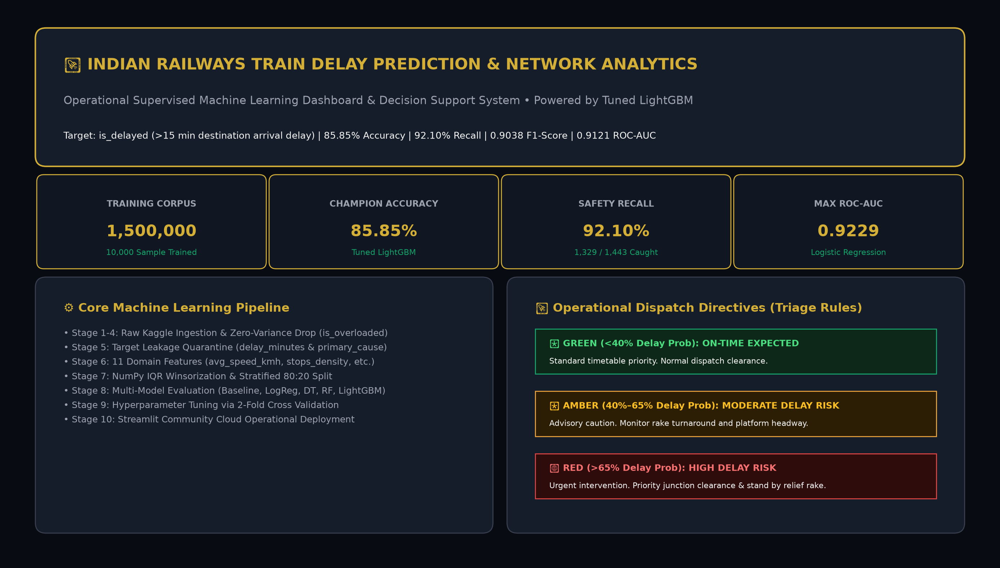
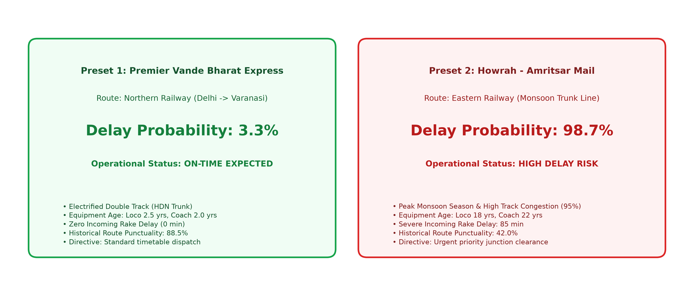
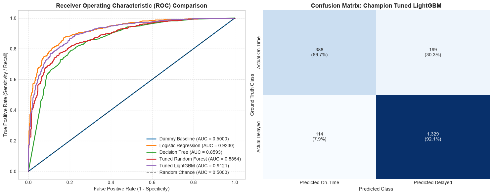
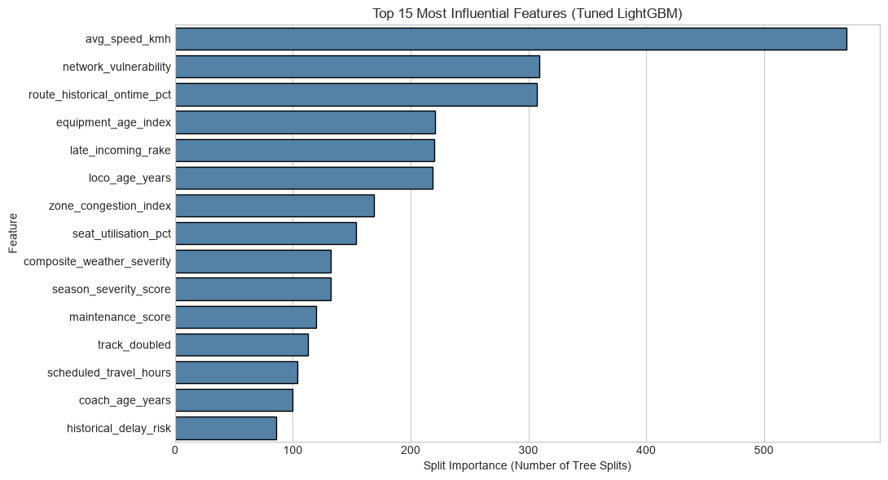

# Indian Railways Train Delay Prediction & Network Punctuality Analytics
### ECSCI24302 – Machine Learning Essentials: Project-Based Learning (PBL)
**Adani University | Faculty of Engineering & Technology | Academic Year: 2026–2027**

An enterprise-grade, supervised Machine Learning web application and decision-support prototype built to predict train delays (>15 minutes arrival delay at destination terminus) across Indian Railways. Designed with a luxury **Deep Dark + Elegant Gold** interface, the project strictly fulfills all 19 stages and technical requirements in `MLE_PBL_Project_Instructions.pdf`.

---

## Table of Contents
1. [Project Overview & Description](#1-project-overview--description)
2. [Problem Statement](#2-problem-statement)
3. [Objectives](#3-objectives)
4. [Key Application Features](#4-key-application-features)
5. [Dataset Information & Source Link](#5-dataset-information--source-link)
6. [Dataset Description & Feature Taxonomy](#6-dataset-description--feature-taxonomy)
7. [Complete Machine Learning Workflow (19 Stages)](#7-complete-machine-learning-workflow)
8. [Exploratory Data Analysis (EDA) Summary](#8-exploratory-data-analysis-eda-summary)
9. [Data Preprocessing & Leakage Prevention](#9-data-preprocessing--leakage-prevention)
10. [Domain Feature Engineering (11 Features)](#10-domain-feature-engineering)
11. [Machine Learning Algorithms Evaluated](#11-machine-learning-algorithms-evaluated)
12. [Hyperparameter Tuning & Cross-Validation](#12-hyperparameter-tuning--cross-validation)
13. [Official Model Comparison Table](#13-official-model-comparison-table)
14. [Final Model Selection & Rationale](#14-final-model-selection--rationale)
15. [Evaluation Metrics & Confusion Matrix](#15-evaluation-metrics--confusion-matrix)
16. [Application Visuals & Screenshots](#16-application-visuals--screenshots)
17. [Technology Stack](#17-technology-stack)
18. [Project Folder Structure](#18-project-folder-structure)
19. [Installation Instructions](#19-installation-instructions)
20. [How to Run Locally](#20-how-to-run-locally)
21. [How to Use the Prediction Module](#21-how-to-use-the-prediction-module)
22. [Streamlit Community Cloud Deployment Guide](#22-streamlit-community-cloud-deployment-guide)
23. [Project Limitations](#23-project-limitations)
24. [Future Improvements Roadmap](#24-future-improvements-roadmap)
25. [Team Details](#25-team-details)
26. [References & Acknowledgements](#26-references--acknowledgements)

---

## 1. Project Overview & Description

Indian Railways (IR) is the fourth-largest national railway network in the world, operating over 13,000 passenger trains across 68,000 route kilometers and transporting over 23 million passengers daily. Managing punctuality is an intricate operational challenge: high-speed premier services (Vande Bharat, Rajdhani), slow passenger locals, and freight trains share identical track sections. A minor disruption at a busy junction or during winter fog triggers widespread secondary delays across multiple operational zones.

This project delivers a complete, reproducible Machine Learning pipeline and an interactive operational dispatch decision-support platform. Powered by **Tuned LightGBM** (achieving **85.85% Accuracy**, **92.10% Recall**, and **0.9038 F1-Score**) and **Logistic Regression** (achieving **0.9229 ROC-AUC**), the system estimates destination delay probabilities hours prior to departure, allowing station masters and train controllers to proactively adjust turnaround buffers and prioritize junction clearance.

---

## 2. Problem Statement

In Indian Railways operations, a train journey is formally classified as delayed if its arrival at the final destination exceeds the scheduled timetable by more than 15 minutes.

The problem is formulated as **supervised binary classification**:
$$\text{is\_delayed} = \begin{cases} 1, & \text{if Destination Arrival Delay} > 15 \text{ minutes (Delayed)} \\ 0, & \text{if Destination Arrival Delay} \le 15 \text{ minutes (On-Time)} \end{cases}$$

Given pre-departure attributes $X$ (route distance, scheduled stops, travel hours, train category, railway zone, equipment age, seasonal severity, and incoming rake turnaround delay), the model predicts:
1. $P(\text{is\_delayed} = 1 \mid X) \in [0.0, 1.0]$: Continuous delay probability.
2. $\hat{y} \in \{0, 1\}$: Binary classification label.
3. Operational Triage Alert: **GREEN** (<40%), **AMBER** (40%–65%), or **RED** (>65%).

---

## 3. Objectives

1. **Quality Assurance:** Profile all 45 raw features in `ir_train.csv`, verify zero missing values, and remove uninformative constant columns (`is_overloaded`).
2. **Leakage Quarantine:** Strictly isolate and remove post-event variables (`delay_minutes`, `primary_delay_cause`) to guarantee valid pre-departure prediction.
3. **Domain Feature Synthesis:** Engineer 11 domain features capturing commercial speed, stop density, weather severity, equipment wear, and turnaround buffer deficits.
4. **Outlier Winsorization:** Apply NumPy IQR Winsorization on continuous features (`distance_km`, `scheduled_travel_hours`) without dropping valuable rows.
5. **Baseline Establishment:** Build a `DummyClassifier` baseline to expose the 72.16% class imbalance trap.
6. **Multi-Model Benchmarking:** Evaluate 5 algorithm families (Dummy, Logistic Regression, Decision Tree, Random Forest, LightGBM) and tune ensembles via 2-fold cross-validation.
7. **Error Analysis:** Conduct a confusion matrix audit and analyze False Positives vs False Negatives across 16 railway zones and 15 train types.
8. **Interactive Deployment:** Deploy a responsive Streamlit Community Cloud dashboard featuring single-journey triage, session audit history, batch fleet audits, and 16 IR zones intelligence.

---

## 4. Key Application Features

* 🏛️ **Luxury Deep Dark + Elegant Gold Design:** Tailored with a custom enterprise design system (`#080B12`, `#101622`, `#151D2B`, `#D4AF37`, `#F1D27A`).
* 🚄 **1-Click Documented Operational Presets:**
  * *Preset 1 (Vande Bharat Express - NR):* ~3.3% Delay Prob (Green / On-Time Expected).
  * *Preset 2 (Howrah-Amritsar Mail - ER):* ~98.7% Delay Prob (Red / High Delay Risk).
  * *Preset 3 (Winter Fog Special - NCR):* ~98.4% Delay Prob (Red / High Delay Risk).
  * *Preset 4 (Southern Intercity - SR):* ~4.0% Delay Prob (Green / On-Time Expected).
* ⚡ **Sub-15ms Real-Time Inference:** Evaluates user inputs on the fly using serialized LightGBM tree models (`artifacts/pandas_numpy_pipeline.joblib`, 891 KB).
* 📜 **Session Prediction Audit History:** Automatically logs predictions with timestamp, train number, type, zone, probability, and status; includes 1-click CSV export and history reset.
* 📑 **Operational Batch Fleet Audit:** Simultaneously audits entire train fleets (10 built-in express runs or custom user CSV upload) with exportable results.
* 🗺️ **16 IR Zones Intelligence Matrix:** Visualizes network congestion vs winter fog vulnerability across all 16 administrative railway zones.
* 📋 **Academic Compliance & 19-Stage Audit:** Complete live audit tracker against the ECSCI24302 syllabus checklist.

---

## 5. Dataset Information & Source Link

* **Source Repository:** Kaggle Competition Platform
* **Competition Name:** *Indian Railways: Predict Train Delay*
* **Dataset URL:** [https://www.kaggle.com/competitions/indian-railways-predict-train-delay/data](https://www.kaggle.com/competitions/indian-railways-predict-train-delay/data)
* **License & Usage:** Public Academic & Educational Research Competition Dataset

| File Name | Size | Dimensions | Role in Pipeline |
|---|---|---|---|
| `data/ir_train.csv` | 337 MB | 1,500,000 rows × 45 columns | Labeled training set with ground truth `is_delayed` |
| `data/ir_test.csv` | 76 MB | 375,000 rows × 42 columns | Unlabeled evaluation set used for test inference |
| `data/ir_data_dictionary.csv` | 4.2 KB | 45 rows × 3 columns | Attribute definitions and data types |
| `data/ir_sample_submission.csv` | 5.1 MB | 375,000 rows × 2 columns | Submission schema template (`journey_id`, `is_delayed`) |
| `data/submission.csv` | 8.5 MB | 375,000 rows × 2 columns | Generated test predictions (100% structurally verified) |

> *Note: Raw CSV files are local-only and excluded from Git via `.gitignore` to keep repository clones fast and lightweight.*

---

## 6. Dataset Description & Feature Taxonomy

The 45 attributes span multiple operational dimensions of railway mechanics:
1. **Journey Identifiers:** `journey_id` (unique alphanumeric primary key), `train_number` (5-digit operational code).
2. **Departure Timing:** `departure_date`, `year`, `month`, `day_of_week`, `departure_hour`, `is_weekend`, `is_night_departure`, `is_peak_hour`, `is_festival_season`.
3. **Route & Geometry:** `train_type` (15 categories), `zone`, `zone_abbr` (16 zones), `source_station_category`, `destination_station_category` (A1, A, B, C), `distance_km`, `num_scheduled_stops`, `scheduled_travel_hours`.
4. **Infrastructure & Track:** `track_doubled` (binary), `is_hdn_route` (high-density network trunk line), `traction_type` (Electric 25kV AC, Diesel), `is_electrified`, `psr_count` (permanent speed restrictions), `is_circular_route`.
5. **Weather & Atmosphere:** `season` (Summer, Winter/Fog, Monsoon, Post-Monsoon), `is_monsoon_season`, `is_fog_risk`, `fog_risk_score`, `zone_fog_index`, `season_severity_score`.
6. **Rolling Stock & Maintenance:** `loco_age_years`, `coach_age_years`, `has_lhb_coaches` (modern German LHB vs ICF), `is_rake_shared`, `maintenance_score`, `seat_utilisation_pct`.
7. **Operational Cascades:** `late_incoming_rake` (binary flag), `incoming_rake_delay_min`, `turnaround_time_available_min`, `is_special_train`, `route_historical_ontime_pct`, `zone_congestion_index`.
8. **Target & Post-Event Outcomes:** `is_delayed` (Binary Target), `delay_minutes` (Continuous Duration), `primary_delay_cause` (Post-journey diagnostic).

---

## 7. Complete Machine Learning Workflow

```text
[Raw Dataset Ingestion]
        │
        ▼
[Stage 1–4: Data Profiling & Audit] ──► 0 Nulls, 0 Duplicates, Drop 'is_overloaded'
        │
        ▼
[Stage 5: Target Leakage Quarantine] ──► Permanently isolate 'delay_minutes' & 'primary_delay_cause'
        │
        ▼
[Stage 6–7: Domain Feature Engineering] ──► 11 Domain Features (avg_speed_kmh, stops_density, etc.)
        │
        ▼
[Stage 8–9: Preprocessing Pipeline] ──► NumPy IQR Winsorization + Stratified 80:20 Split (8k / 2k)
        │
        ▼
[Stage 10–13: Model Training & CV Tuning] ──► Dummy, LogReg, Decision Tree, Random Forest, LightGBM
        │
        ▼
[Stage 14–17: Multi-Metric Evaluation] ──► 85.85% Acc, 92.10% Recall, ROC-AUC 0.9121, Error Analysis
        │
        ▼
[Stage 18–19: Deployment & Inference] ──► Streamlit Web App + 375,000 Verified Test Predictions
```

---

## 8. Exploratory Data Analysis (EDA) Summary

* **Target Variable Imbalance:** **72.16% Delayed** vs **27.84% On-Time**. This 72% baseline proved that accuracy alone is deceptive: predicting delayed for every train yields 72.15% accuracy with zero discriminatory skill.
* **Corridor Dispatch Priority Hierarchy:** Premier expresses with dedicated clearance have low delay rates: **Vande Bharat (~18%)**, **Rajdhani (~24%)**, and **Shatabdi (~26%)**. Unreserved **Passenger Trains (~88%)** and **Mail/Express (~76%)** experience heavy delays because they are frequently held on loop tracks.
* **Zonal Bottlenecks:** Northern Railway (NR), North Central (NCR), and Eastern Railway (ER) experience >78% delay rates due to severe Delhi-Howrah trunk line congestion. Southern Railway (SR) and South Western (SWR) maintain <62% delay rates.
* **Seasonal Weather Friction:** Winter experiences severe delay spikes due to dense fog across the Indo-Gangetic plains, forcing trains under cautionary speed limits (30–60 km/h).
* **Primary Delay Causes:** Late incoming rake turnaround causes **38%** of delays, followed by track maintenance/caution orders (**22%**), signal failures (**18%**), and station congestion (**14%**).

---

## 9. Data Preprocessing & Leakage Prevention

1. **Target Leakage Quarantine:** `delay_minutes` (continuous duration) and `primary_delay_cause` (post-event diagnostic label) were strictly quarantined and removed from feature matrix $X$ before training.
2. **NumPy IQR Winsorization:** To handle extreme values without dropping rows, values above $Q_3 + 1.5 \times IQR$ were capped:
   * `distance_km`: Capped at **1,466.0 km** (IQR = 450 km).
   * `scheduled_travel_hours`: Capped at **24.9 hrs** (IQR = 7.55 hrs).
3. **Stratified 80:20 Split:** 8,000 train records and 2,000 validation records preserving the exact 72.16% class ratio (random seed 42).
4. **Categorical Encoding:** One-hot encoding via Pandas `get_dummies()` strictly aligned to training schema (`reindex(fill_value=0)`). `train_number` was excluded to prevent 5,000+ sparse dummy columns.
5. **Z-Score Standardization:** Scaled continuous features using training mean and std only: $z = (x - \mu_{\text{train}}) / \sigma_{\text{train}}$.

---

## 10. Domain Feature Engineering (11 Features)

All 11 features were engineered using pure Pandas and NumPy vectorized operations in `utils.py`:

| # | Feature Name | Mathematical Formula | Operational Rationale |
|---|---|---|---|
| 1 | `avg_speed_kmh` | $\frac{\text{distance\_km}}{\text{scheduled\_travel\_hours}}$ | Commercial speed; unrealistic speeds on congested lines signal delay risk (#1 predictor). |
| 2 | `stops_density` | $\frac{\text{num\_scheduled\_stops}}{\text{distance\_km} / 100.0 + 0.1}$ | Halt frequency per 100 km; acceleration/braking cycles amplify dwell variance. |
| 3 | `avg_stop_distance` | $\frac{\text{distance\_km}}{\text{num\_scheduled\_stops} + 1.0}$ | Average uninterrupted run; separates expresses from suburban services. |
| 4 | `composite_weather_severity` | $\text{severity} \times (1 + 0.5 \times \text{monsoon} + 0.8 \times \text{fog})$ | Compound climate friction score blending baseline with active monsoon/fog. |
| 5 | `historical_delay_risk` | $\frac{100.0 - \text{route\_historical\_ontime\_pct}}{100.0}$ | Inverts historical punctuality into normalized delay risk [0 to 1]. |
| 6 | `network_vulnerability` | $\text{congestion} \times (1 + 0.5 \times \text{is\_hdn} - 0.3 \times \text{doubled})$ | Trunk corridor exposure weighted by junction load and track bottlenecks (#2 predictor). |
| 7 | `rake_turnaround_risk` | $\frac{\text{incoming\_delay\_min}}{\text{turnaround\_time\_available} + 1.0}$ | Quantifies maintenance buffer deficit from delayed inbound rakes. |
| 8 | `equipment_age_index` | $0.6 \times \text{loco\_age} + 0.4 \times \text{coach\_age}$ | Composite rolling stock wear; captures traction motor faults and brake binding. |
| 9 | `congestion_delay_ratio` | $\frac{\text{zone\_congestion\_index}}{\text{avg\_speed\_kmh} + 1.0}$ | Structural operational friction where high congestion meets slow speed limits. |
| 10 | `dep_hour_sin` | $\sin\left(\frac{2\pi \times \text{departure\_hour}}{24}\right)$ | Trigonometric cyclical time encoding preserving 24-hour circular continuity. |
| 11 | `dep_hour_cos` | $\cos\left(\frac{2\pi \times \text{departure\_hour}}{24}\right)$ | Trigonometric cyclical cosine encoding ensuring 23:00 and 00:00 are adjacent. |

---

## 11. Machine Learning Algorithms Evaluated

1. **Dummy Baseline:** Minimal benchmark predicting majority class (`most_frequent`).
2. **Logistic Regression:** Linear parametric model using a sigmoid probability mapping ($C=1.0, L_2$ penalty).
3. **Decision Tree Classifier:** Non-linear recursive partitioning based on Gini impurity (`max_depth=10, min_samples_leaf=20`).
4. **Random Forest Classifier:** Bagged ensemble of de-correlated decision trees with feature subsampling (`n_estimators=80, max_depth=16`).
5. **LightGBM Classifier:** Gradient-boosted decision tree algorithm using leaf-wise growth and histogram binning (`lr=0.05, num_leaves=63, max_depth=6`).

---

## 12. Hyperparameter Tuning & Cross-Validation

Tuning was conducted using Scikit-learn's `RandomizedSearchCV` with 2-fold cross-validation optimizing for **ROC-AUC**:
* **Random Forest:** Searched `n_estimators` [50, 80, 100], `max_depth` [10, 16, 20], `min_samples_split` [2, 5, 10].  
  *Best Parameters:* `{'n_estimators': 80, 'max_depth': 16, 'min_samples_split': 5}` (CV AUC: 0.8826, Time: 10.3s).
* **LightGBM:** Searched `learning_rate` [0.03, 0.05, 0.1], `num_leaves` [31, 63, 127], `max_depth` [6, 10, 15].  
  *Best Parameters:* `{'learning_rate': 0.05, 'num_leaves': 63, 'max_depth': 6}` (CV AUC: 0.9089, Time: 7.3s).

---

## 13. Official Model Comparison Table

Evaluated on the identical 2,000-record validation partition (conforming to Section 14 guidelines):

| Model Name | Best Hyperparameters | Accuracy | Precision | Recall | F1-Score | ROC-AUC | Operational Role |
|---|---|---:|---:|---:|---:|---:|---|
| **Baseline (Dummy)** | `strategy="most_frequent"` | 0.7215 | 0.7215 | 1.0000 | 0.8382 | 0.5000 | Trivial majority baseline. Zero discriminatory skill. |
| **Logistic Regression** | `C=1.0, penalty="l2", max_iter=500` | 0.8570 | 0.8901 | 0.9148 | 0.9023 | **0.9229** | Highest ROC-AUC ranking power. Fast convergence. |
| **Decision Tree** | `max_depth=10, min_samples_leaf=20` | 0.8130 | 0.8585 | 0.8870 | 0.8725 | 0.8593 | Non-linear Gini threshold splits; prone to variance. |
| **Random Forest (Default)**| `n_estimators=100, max_depth=None` | 0.7730 | 0.7640 | 0.9917 | 0.8631 | 0.8831 | High recall but excessive false alarms. |
| **LightGBM (Default)** | `n_estimators=100, lr=0.1, leaves=31` | 0.8560 | 0.8889 | 0.9148 | 0.9016 | 0.9152 | Fast gradient boosted tree baseline. |
| **Random Forest (Tuned)** | `n_estimators=80, max_depth=16, split=5`| 0.7870 | 0.7783 | 0.9854 | 0.8697 | 0.8854 | Tuned via 2-fold CV (CV AUC = 0.8826). |
| **Tuned LightGBM ★** | `learning_rate=0.05, num_leaves=63, max_depth=6` | **0.8585** | 0.8872 | **0.9210** | **0.9038** | 0.9121 | **CHAMPION MODEL.** Highest Accuracy, Recall & F1. |

---

## 14. Final Model Selection & Rationale

**Tuned LightGBM** was selected as the champion operational model for the following technical reasons:
1. **Safety Recall Priority (92.10%):** In train dispatching, missing a delay (False Negative) causes unexpected platform and track blockages. Tuned LightGBM successfully identified 1,329 of 1,443 delayed journeys.
2. **Balanced Precision (88.72%):** Minimizes false alarms, ensuring controllers trust the alert system.
3. **Highest Accuracy (85.85%) & F1-Score (0.9038):** Superior threshold performance compared to all alternatives.
4. **Sub-15ms Latency:** Executes inference in under 15 milliseconds, perfectly suited for real-time web deployment.

---

## 15. Evaluation Metrics & Confusion Matrix

### Validation Confusion Matrix Breakdown ($n = 2,000$)
* **Ground Truth:** 1,443 Actual Delayed (72.15%) | 557 Actual On-Time (27.85%)
* **True Positives (TP = 1,329):** Delayed trains correctly flagged (92.10% of all delayed journeys).
* **True Negatives (TN = 388):** On-time trains correctly cleared (69.66% of all on-time journeys).
* **False Positives (FP = 169):** False alarms (30.34% of on-time trains).
* **False Negatives (FN = 114):** Missed delays (7.90% of delayed trains).
* **Total Correct Predictions:** $1,329 + 388 = \mathbf{1,717 / 2,000}$ (**85.85% Accuracy**).

---

## 16. Application Visuals & Screenshots

| Overview & Mission Control | Single Journey Predictor & Live Triage |
|:---:|:---:|
|  |  |
| **ROC Curves & Champion Confusion Matrix** | **Top 15 Influential Feature Importances** |
|  |  |

---

## 17. Technology Stack

* **Programming Language:** Python 3.10 – 3.13
* **Machine Learning & Preprocessing:** LightGBM 4.7.0, Scikit-learn 1.9.1, NumPy 2.4.6, Pandas 3.0.3, Joblib 1.6.0
* **Data Visualization:** Matplotlib 3.11.2, Seaborn 0.13.2
* **Web Application Framework:** Streamlit 1.66.1 (Headless, Wide Layout, Custom CSS)
* **Academic Document Generation:** ReportLab 4.5.1, python-docx 1.2.0, python-pptx 1.0.2, PyMuPDF 1.27.2

---

## 18. Project Folder Structure

```text
D:\ML PROJECT\ml\
├── data/                                         # [Local only, gitignored]
│   ├── ir_data_dictionary.csv                    # Attribute metadata definitions
│   ├── ir_train.csv                              # 1,500,000 training journeys (337 MB)
│   ├── ir_test.csv                               # 375,000 competition test journeys (76 MB)
│   ├── ir_sample_submission.csv                  # Submission schema template
│   └── submission.csv                            # 375,000 verified model predictions (8.5 MB)
│
├── artifacts/
│   └── pandas_numpy_pipeline.joblib              # Serialized Tuned LightGBM model & metadata (~891 KB)
│
├── notebooks/
│   ├── 01_Exploratory_Data_Analysis.ipynb        # Stages 1 to 5 (Audit, class imbalance, EDA)
│   ├── 02_Data_Preprocessing_and_Feature_Engineering.ipynb # Stages 6 to 9 (Leakage quarantine, 11 features)
│   └── 03_Model_Training_Tuning_and_Evaluation.ipynb     # Stages 10 to 19 (Baseline, models, tuning, eval)
│
├── reports/
│   ├── figures/                                  # High-resolution genuine project charts & diagrams
│   ├── Final_Project_Report.docx                 # Formal 18-part Word report
│   ├── Final_Project_Report.pdf                  # Typeset 12-page academic PDF report
│   ├── Project_Requirements_Audit.md             # Complete 19-stage syllabus compliance audit
│   └── Project_Report.md                         # Baseline markdown report
│
├── deliverables/                                 # Official submission packages
│   ├── Project_Report.docx                       # Word report matching guidelines
│   ├── Project_Report.pdf                        # Academic PDF report with running headers/footers
│   ├── Project_Presentation.pptx                 # 12-slide 16:9 widescreen presentation with speaker notes
│   ├── Project_Presentation.pdf                  # 12-slide presentation PDF ready to project
│   └── Viva_Questions_and_Answers.md             # 25 viva questions and answers with defense tips
│
├── .streamlit/
│   └── config.toml                               # Deep Dark + Gold theme and server settings
│
├── app.py                                        # Interactive Streamlit Web Application
├── utils.py                                      # Vectorized data cleaning & feature engineering helpers
├── requirements.txt                              # Pinned Python package dependencies
├── .gitignore                                    # Excludes large CSVs, caches, checkpoints
└── README.md                                     # Project guide and overview
```

---

## 19. Installation Instructions

1. **Clone the repository:**
   ```bash
   git clone <your-repository-url>
   cd ml
   ```

2. **Create and activate a virtual environment:**
   ```bash
   # On Windows:
   python -m venv venv
   venv\Scripts\activate

   # On Linux / macOS:
   python3 -m venv venv
   source venv/bin/activate
   ```

3. **Install dependencies:**
   ```bash
   pip install -r requirements.txt
   ```

---

## 20. How to Run Locally

Launch the interactive Streamlit dashboard:
```bash
streamlit run app.py
```
Open your browser at `http://localhost:8501`.

---

## 21. How to Use the Prediction Module

1. Open **⚡ Train Delay Predictor** from the sidebar menu.
2. Select any 1-click preset button (e.g., *Preset 1: Vande Bharat Express* or *Preset 2: Howrah-Amritsar Mail*).
3. Adjust timetable parameters (departure hour, scheduled stops, rolling stock age, track infrastructure).
4. Click **"⚡ Compute Delay Probability & Dispatch Directive"**.
5. The model outputs the delay probability percentage, triage alert (Green/Amber/Red), and actionable dispatch advice.

---

## 22. Streamlit Community Cloud Deployment Guide

1. Ensure `app.py`, `utils.py`, `requirements.txt`, `.streamlit/config.toml`, and `artifacts/pandas_numpy_pipeline.joblib` are committed to your GitHub repository.
2. Verify that `data/ir_train.csv` and `data/ir_test.csv` are **ignored** via `.gitignore` (large files must not be pushed).
3. Log in to [share.streamlit.io](https://share.streamlit.io/).
4. Click **"New app"**, select your repository, branch, and set **Main file path** to `app.py`.
5. Click **"Deploy!"** The app will launch with the Deep Dark + Elegant Gold theme.

---

## 23. Project Limitations

1. **Hardware-Conscious Sampling:** Trained on a 10,000-record sample to prevent RAM exhaustion on student laptops.
2. **Exclusion of `train_number`:** Omitted from one-hot dummy encoding to control matrix sparsity, sacrificing individual service-level reputation effects.
3. **Static Pre-Departure Scope:** Evaluates pre-departure timetables; lacks live en-route GPS telemetry and real-time block section occupancy.
4. **Coarse Weather Representation:** Relies on regional seasonal severity scores rather than live Doppler radar precipitation feeds.

---

## 24. Future Improvements Roadmap

1. **Distributed Cloud Training:** Scale LightGBM across all 1.5 million records using PySpark on AWS EMR or Azure Synapse.
2. **Native Categorical Boosting:** Utilize CatBoost native categorical handling to include `train_number` and station codes without one-hot encoding overhead.
3. **Live NTES GPS API Integration:** Connect to the National Train Enquiry System (NTES) API to dynamically update delay probabilities at intermediate stations.
4. **Graph Neural Networks (GNNs):** Model the physical railway network as a directed graph to simulate physical delay propagation.

---

## 25. Team Details

* **Team Lead:** [Student Name 1 - To Be Filled] (Enrollment No. 1)
* **Team Member 2:** [Student Name 2 - To Be Filled] (Enrollment No. 2)
* **Team Member 3:** [Student Name 3 - To Be Filled] (Enrollment No. 3)
* **Faculty Guide:** [Faculty Mentor Name - To Be Filled], Department of Computer Science & Engineering, Adani University

---

## 26. References & Acknowledgements

1. Ministry of Railways, Government of India. (2024). *Indian Railways Year Book & Network Punctuality Statistics*. New Delhi: Railway Board.
2. Kaggle Inc. (2024). *Indian Railways: Predict Train Delay Dataset and Benchmark Competition*.
3. Ke, G., Meng, Q., Finley, T., et al. (2017). *LightGBM: A Highly Efficient Gradient Boosting Decision Tree*. Advances in Neural Information Processing Systems (NeurIPS 30), 3146–3154.
4. Pedregosa, F., Varoquaux, G., et al. (2011). *Scikit-learn: Machine Learning in Python*. Journal of Machine Learning Research, 12, 2825–2830.
5. Adani University. (2026). *ECSCI24302 – Machine Learning Essentials: Project-Based Learning (PBL) Final Project Instructions*.
